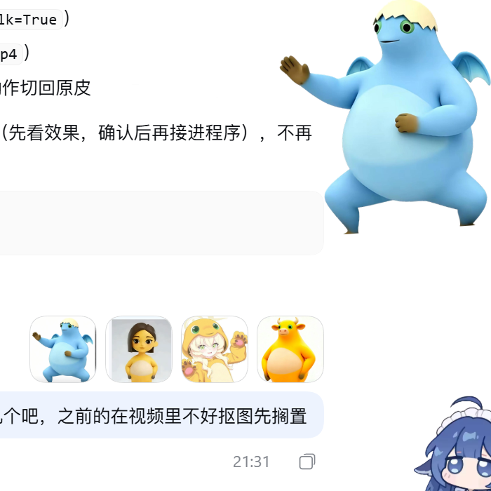
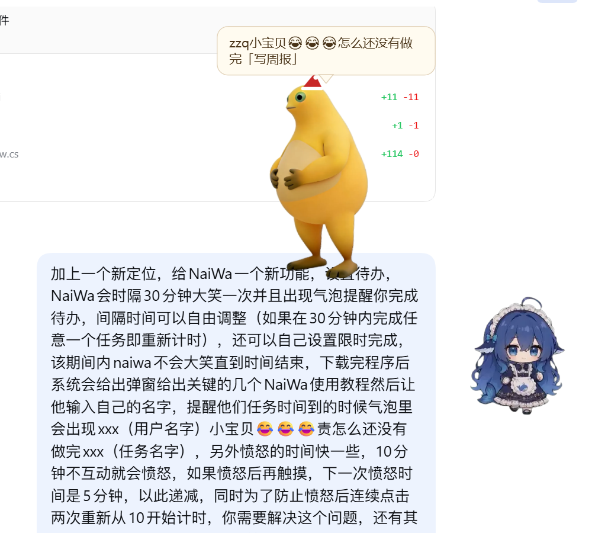

# NaiWa 桌宠

一个会大笑、会走动、会催你完成待办的 Windows 桌面宠物。单文件 exe，双击即用。




## 功能

- 透明、无边框、始终置顶，默认停在屏幕右下角
- **自由走动**：随机左右移动、到屏幕边缘掉头；愤怒时走得更快
- **单击大笑**：播放动作 + 音效；透明区域点击穿透
- **待办与专注**：
  - 右键 → 待办，添加/完成/删除任务
  - 按设定间隔（默认 30 分钟）提醒，气泡显示「{名字}小宝贝😂😂😂怎么还没有做完「任务」」
  - 完成任意任务重新计时；可设置限时专注，期间不自动打扰
- **首次启动引导**：教程 + 输入称呼（用于提醒气泡）
- **愤怒机制**：10 分钟无互动开始愤怒，之后阈值递减 5→4→3→2→1 分钟；点击不会把阈值重置回 10
- **皮肤**：原皮 / 蓝翼 / 女生 / 兜帽娘 / 牛牛；待机/走路用皮肤，动作切回原皮
- 右键菜单：大小、待办、设置、静音、重置位置、退出
- 托盘图标（在任务栏 ^ 里）：显示 / 隐藏 / 待办 / 设置 / 退出

## 下载

[Releases](https://github.com/zzq4546-arch/NaiWa/releases) → `NaiWa-v0.3.0-win64.zip`，解压后双击 `NaiWa.exe`。

首次运行若出现 SmartScreen 提示：**更多信息 → 仍要运行**。

## 构建

需要 Windows 10/11 自带的 .NET Framework（无需安装 SDK）：

```bat
build.cmd
```

生成 `NaiWa.exe`，素材全部内嵌。

## 目录

```
build.cmd
src/            C# 源码（WPF，纯代码）
assets/         动作帧、音效、皮肤
screenshots/
```

## 已知限制

- 仅 Windows x64
- exe 未签名，可能出现 SmartScreen 提示
- 皮肤只影响待机/走路；动作仍使用原皮
- 视频动作库（抱头笑/弯腰/笑倒）尚未接入，待后续抽取
- 未指定开源许可证；角色素材权利归原作者
