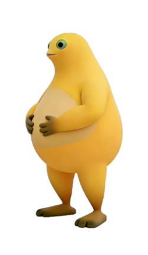

# NaiWa 桌宠

一个会大笑的 Windows 桌面宠物。单文件 exe，双击即用，不需要安装任何运行时。




## 功能

- 透明、无边框、始终置顶，默认停在屏幕右下角
- 待机时轻微呼吸起伏
- **单击：播放 3 秒「大笑」动画，并播放笑声**
- 按住拖动；松开后记住位置，自动限制在屏幕内
- 右键菜单：大小（小 / 标准 / 大）、静音、开机自启、重置位置、退出
- 托盘图标（Windows 默认收进任务栏 `^`）：显示 / 隐藏 / 退出
- 透明区域像素级点击穿透，不挡桌面操作
- 单实例运行，不占任务栏、不进 Alt+Tab
- 位置、大小、静音、开机自启保存在 exe 同目录的 `NaiWa-settings.ini`

## 下载

前往 [Releases](https://github.com/zzq4546-arch/NaiWa/releases) 下载：

- `NaiWa-v0.2.0-win64.zip` — 解压后双击 `NaiWa.exe`

## 运行

1. 解压 zip
2. 双击 `NaiWa.exe`
3. 首次运行可能出现 SmartScreen 提示：**更多信息 → 仍要运行**
4. 找不到托盘图标时，点任务栏右下角的 `^` 展开

退出：右键桌宠 → 退出，或托盘图标 → 退出。

## 操作

| 操作 | 效果 |
| --- | --- |
| 单击 | 大笑（动画 + 声音） |
| 按住拖动 | 移动位置（自动记忆） |
| 右键 | 大小 / 静音 / 开机自启 / 重置位置 / 退出 |
| 托盘双击 | 显示桌宠 |

## 构建

需要 Windows 10/11 自带的 .NET Framework（无需安装 Visual Studio / .NET SDK）。

```bat
build.cmd
```

生成 `NaiWa.exe`，并把 `assets/` 里的图片和音频嵌入 exe。

技术栈：C# + WPF（纯代码，无 XAML），用 `csc.exe` 编译，单文件约 5 MB。

## 目录

```
.
├─ build.cmd              # 一键编译
├─ src/                   # C# 源码
│  ├─ Program.cs          # 入口、单实例、托盘
│  ├─ PetWindow.cs        # 窗口、动画、点击穿透、菜单
│  ├─ TrayIcon.cs         # 托盘图标
│  ├─ Settings.cs         # 设置持久化
│  └─ Log.cs              # 轻量日志
├─ assets/
│  ├─ naiwa-idle.png      # 待机立绘
│  ├─ naiwa-laugh-strip.png  # 45 帧大笑动画帧条
│  ├─ naiwa-laugh.wav     # 笑声
│  └─ naiwa.ico           # 图标
└─ screenshots/
```

## 动画是怎么来的

1. 从提供的视频中截取 2.5–5.5 秒的大笑片段，15fps 抽成 45 帧
2. 逐帧抠掉白色影棚背景与地面阴影（保留手臂投影）
3. 去掉录制时留在画面里的手型鼠标光标
4. 缩放到 300×480，横向拼成帧条，和音频一起内嵌进 exe
5. 点击时用 `DispatcherTimer` 以 15fps 切换 `CroppedBitmap`，播放完回到待机

## 已知限制

- 仅支持 Windows x64（Win10/11）
- exe 未签名，SmartScreen 会提示；杀毒软件可能误报
- 大笑每次点击播放一遍，播放中再点会重新开始
- 开机自启写 `HKCU\Software\Microsoft\Windows\CurrentVersion\Run`

## 许可

未指定开源许可证，代码与素材仅供学习交流；商用或转载请联系作者。
